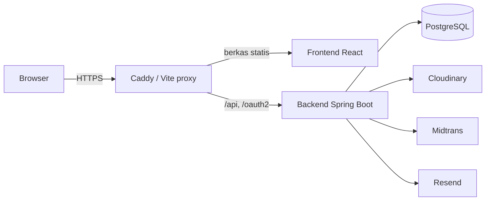

# Vendoria

Platform penyewaan alat event yang mempertemukan **penyewa**, **vendor**, dan **admin**: dari mencari alat, membayar deposit, serah terima dengan bukti foto, sampai pengembalian dana dan ulasan.


## Daftar isi

- [Fitur](#fitur)
- [Alur penyewaan](#alur-penyewaan)
- [Teknologi](#teknologi)
- [Arsitektur](#arsitektur)
- [Memulai](#memulai)
- [Variabel lingkungan](#variabel-lingkungan)
- [Pemeriksaan dan pengujian](#pemeriksaan-dan-pengujian)
- [Deployment](#deployment)
- [Struktur proyek](#struktur-proyek)
- [Tim pengembang](#tim-pengembang)
- [Berkontribusi](#berkontribusi)
- [Lisensi](#lisensi)

## Fitur

**Penyewa**

- Katalog dengan pencarian, filter kategori dan kota, serta pencarian kota vendor terdekat
- Wishlist, keranjang, dan pemesanan per vendor
- Verifikasi identitas (KYC) sebelum memesan
- Pembayaran deposit dan pelunasan lewat Midtrans
- Laporan pesanan bermasalah, ulasan, dan notifikasi
- Masuk dengan Google, lupa kata sandi lewat OTP email, dan verifikasi dua langkah

**Vendor**

- Profil bisnis, KYC, dan pengelolaan katalog beserta foto
- Konfirmasi pesanan serta serah terima dan pengembalian dengan foto kondisi
- Laporan kerusakan dan pencairan dana (biaya platform 6%)
- Dashboard, pencarian, dan notifikasi

**Admin**

- Verifikasi KYC dan keputusan atas laporan
- Pengelolaan pengembalian dana dan pencairan vendor
- Pengelolaan pengguna, administrator, kategori, dan katalog
- Laporan transaksi dengan unduhan CSV

## Alur penyewaan

1. Penyewa mendaftar dan menyelesaikan verifikasi KYC.
2. Penyewa memilih alat, membuat pesanan, lalu membayar **deposit** jaminan (maksimal 60% dari biaya sewa) dalam 24 jam.
3. Vendor mengonfirmasi dalam 24 jam. Jika tidak, pesanan batal dan deposit dikembalikan.
4. Penyewa **melunasi** biaya sewa.
5. Vendor mengunggah foto kondisi dan menyerahkan barang.
6. Setelah barang kembali dan diperiksa, pesanan selesai dan deposit ditransfer admin ke rekening penyewa. Deposit hangus bila laporan kerusakan disetujui admin.
7. Penyewa memberi ulasan.

Bila ada masalah selama sewa, penyewa dapat membuat laporan yang diputuskan oleh admin.

## Teknologi

| Lapisan | Teknologi |
|---|---|
| Frontend | React 19, Vite 8, React Router 7, Tailwind CSS 4 |
| Backend | Spring Boot 4.2, Java 25, Maven Wrapper |
| Database | PostgreSQL |
| Pembayaran | Midtrans |
| Penyimpanan berkas | Cloudinary (dokumen KYC disimpan terenkripsi) |
| Email | Resend |
| Deployment | Docker Compose dan Caddy (HTTPS otomatis) |

## Arsitektur



Browser hanya berbicara ke satu domain, sehingga cookie sesi tidak melintasi origin.

## Memulai

### Prasyarat

| Perangkat | Versi |
|---|---|
| Git | bebas |
| Node.js | `^20.19.0` atau `>=22.12.0` |
| JDK | 25 atau lebih baru |
| PostgreSQL | diuji dengan 18 |

Maven tidak perlu dipasang karena backend membawa Maven Wrapper.

### 1. Ambil kode

```bash
git clone https://github.com/4nDyD4f1/Vendoria-App.git
cd Vendoria-App
npm ci
```

### 2. Siapkan database

Untuk database **baru**:

```bash
psql -U postgres -c "CREATE DATABASE db_vendoria"
psql -U postgres -d db_vendoria -v ON_ERROR_STOP=1 -f backend/db/schema.sql
psql -U postgres -d db_vendoria -f backend/db/seed-catalog-categories.sql
```

Untuk database yang **sudah ada**, jangan muat `schema.sql` lagi. Jalankan hanya skrip `backend/db/add-*.sql` yang belum pernah dijalankan.

### 3. Buat berkas `.env`

Letakkan `.env` di folder root (sejajar `package.json`). Berkas ini diabaikan git dan **tidak boleh di-commit**.

```env
DB_PASSWORD=password-postgres-kamu

# Dibutuhkan untuk unggah foto
CLOUDINARY_CLOUD_NAME=
CLOUDINARY_API_KEY=
CLOUDINARY_API_SECRET=

# Dibutuhkan untuk pembayaran (kunci sandbox berawalan SB-)
MIDTRANS_SERVER_KEY=
MIDTRANS_IS_PRODUCTION=false
```

### 4. Jalankan

Terminal pertama, backend di `http://localhost:8080`:

```bash
cd backend
./mvnw spring-boot:run        # Windows: .\mvnw spring-boot:run
```

Terminal kedua, frontend di `http://localhost:5173`:

```bash
npm run dev
```

Gunakan `localhost` (bukan `127.0.0.1`) karena cookie sesi dan login Google terikat ke nama tersebut.

### 5. Buat admin pertama

Isi `BOOTSTRAP_ADMIN_EMAIL` dan `BOOTSTRAP_ADMIN_PASSWORD` (8–72 karakter) di `.env`, lalu jalankan ulang backend. Akun dibuat hanya bila belum ada admin. Hapus kedua baris itu setelah berhasil login.

## Variabel lingkungan

| Variabel | Fungsi |
|---|---|
| `DB_URL`, `DB_USER`, `DB_PASSWORD` | Koneksi database. Bawaan: `db_vendoria` di `localhost:5432`, user `postgres` |
| `CLOUDINARY_CLOUD_NAME`, `CLOUDINARY_API_KEY`, `CLOUDINARY_API_SECRET` | Penyimpanan foto dan dokumen |
| `MIDTRANS_SERVER_KEY`, `MIDTRANS_IS_PRODUCTION` | Pembayaran |
| `MIDTRANS_SANDBOX_AUTO_CONFIRM` | Khusus sandbox: pembayaran dilunasi otomatis untuk demo |
| `Resend`, `RESEND_FROM` | Email OTP (nama variabel `Resend` memakai huruf besar R) |
| `GOOGLE_CLIENT_ID`, `GOOGLE_CLIENT_SECRET`, `GOOGLE_REDIRECT_URI` | Login Google. Redirect lokal: `http://localhost:8080/login/oauth2/code/google` |
| `BOOTSTRAP_ADMIN_EMAIL`, `BOOTSTRAP_ADMIN_PASSWORD` | Admin pertama |
| `KYC_STORAGE_DIR` | Lokasi kunci enkripsi KYC. Wajib ikut dibackup |
| `FRONTEND_URL`, `CORS_ORIGINS`, `SESSION_COOKIE_SECURE`, `FORWARD_HEADERS_STRATEGY` | Pengaturan produksi |

Format: satu `NAMA=nilai` per baris, tanpa spasi di sekitar `=` dan tanpa tanda kutip.

## Pemeriksaan dan pengujian

```bash
npm run lint
npm run build
```

Test backend memerlukan PostgreSQL. Gunakan **database uji terpisah** yang sudah dimuati `schema.sql`, jangan database yang berisi data penting:

```bash
cd backend
DB_URL=jdbc:postgresql://localhost:5432/db_vendoria_test ./mvnw test
```

Layar desain Figma dapat ditinjau di rute `/interface-review`.

## Deployment

Seluruh aplikasi berjalan di satu server dengan Docker Compose.

```bash
cp deploy/env.production.example .env    # isi DOMAIN, DB_PASSWORD, dan kunci layanan
docker compose up -d db
docker compose exec -T db psql -U vendoria -d db_vendoria -v ON_ERROR_STOP=1 < backend/db/schema.sql
docker compose exec -T db psql -U vendoria -d db_vendoria < backend/db/seed-catalog-categories.sql
docker compose up -d --build
```

Record DNS `DOMAIN` harus mengarah ke server, dengan port 80 dan 443 terbuka. Daftarkan `https://<DOMAIN>/api/payments/midtrans/notify` sebagai Notification URL di Midtrans.

**Memperbarui versi** (cadangkan database dulu, lalu jalankan skrip `add-*.sql` baru bila ada):

```bash
docker compose exec -T db pg_dump -U vendoria db_vendoria | gzip > backup-$(date +%F).sql.gz
git pull
docker compose up -d --build
```

> [!WARNING]
> Jangan jalankan `docker compose down -v`. Perintah itu menghapus database dan kunci enkripsi KYC.

## Struktur proyek

```text
Vendoria-App/
├── backend/             # API Spring Boot
│   ├── db/              # skema dan skrip migrasi SQL
│   └── src/             # kode dan test
├── deploy/              # Dockerfile web, Caddyfile, contoh .env produksi
├── public/              # aset statis
├── src/                 # frontend React
│   ├── components/      # komponen bersama
│   ├── data/            # data statis (artikel blog)
│   └── features/        # admin, vendor, kyc, interface (penyewa)
└── docker-compose.yml
```

## Tim pengembang

**Kelompok 5**

| No | Nama | NIM |
|:--:|---|---|
| 1 | Andy Muhammad Dafi Tombolotutu | J0403251066 |
| 2 | Mouzia Syawalova Merro | J0403251080 |
| 3 | Muhammad Lutfi Ramadhan Warendra | J0403251070 |
| 4 | Shofia Aziza Iman | J0403251050 |
| 5 | Wildhan Dzikrihantara | J0403251098 |

## Berkontribusi

Kontribusi sangat diterima. Baca [panduan kontribusi](.github/CONTRIBUTING.md) untuk alur kerja, standar perubahan, dan cara mengirim pull request.

## Lisensi

Proyek ini belum memiliki lisensi. Jangan menggunakan ulang atau mendistribusikan kode di luar kontribusi untuk repository ini sebelum pemilik proyek menentukan lisensinya.
